# Proyecto Integrador — Edder  
**Curso:** Introduction to Agentic AI  
**Alumno:** Oscar Gustavo López Vázquez  
**Tutor:** Miguel Ángel Trujillo Monrroy  
**Bloque:** M05–M08  
**Fecha:** 15 de octubre de 2026  

## Índice
1. Mapeo del proceso (M05)  
2. Tracker de métricas agentic + Reporte (M06)  
3. Prototipo (M07)  
4. Log de prompts RGC (M07)  
5. Business Concept Document (M08 F1)  
6. Feedback de usuarios (M08 F3)  
7. Risk Assessment (M08 F4)  
8. Executive Summary (M08 F5)  
9. Referencias  
10. Anexo: Checklist de rúbrica  

---

# 0. Mapeo del proceso (M05)

## Sustento
Edder resuelve la fricción de extraer ideas centrales desde audio conversacional para convertirlas en insumos útiles de divulgación. El valor del agente está en reducir tiempo manual, estandarizar la extracción semántica y habilitar reutilización multiformato.

## AS-IS vs TO-BE

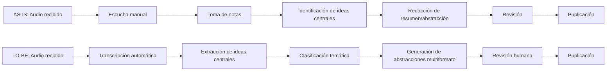

## Tabla del proceso
| Paso | Responsable | Tiempo actual | Tiempo con IA | Ahorro % |
|---|---|---:|---:|---:|
| Recepción de audio | Usuario / editor | 5 min | 5 min | 0% |
| Escucha y comprensión | Editor | 40 min | 8 min | 80% |
| Extracción de ideas | Editor | 30 min | 5 min | 83% |
| Redacción de síntesis | Editor | 35 min | 10 min | 71% |
| Revisión final | Editor | 15 min | 10 min | 33% |
| **Total** |  | **125 min** | **38 min** | **69.6%** |

---

# 1. Tracker de métricas agentic + Reporte (M06)

## Configuración del tracker en n8n
El tracker se configuró con un flujo automatizado que:
- recibe eventos desde el prototipo,
- registra cada ejecución del agente,
- consolida resultados en una base estructurada,
- y envía métricas a un tablero de seguimiento.

### Flujo
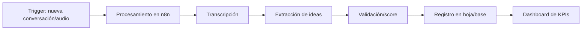

## KPIs
| Métrica | Definición | Fórmula | Meta | Valor actual | Frecuencia |
|---|---|---|---|---|---|
| Tasa de extracción útil | % de audios con ideas relevantes detectadas | casos útiles / total casos | 85% | 50% | Semanal |
| Tiempo de procesamiento | Minutos por audio | tiempo total / audios | <10 min | >60 min | Diario |
| Precisión temática | Coincidencia con tema esperado | aciertos / total | 90% | 65% | Semanal |
| Satisfacción usuario | Evaluación promedio | promedio encuesta | 4.5/5 | 1/5 | Por iteración |

## Evolución de métricas
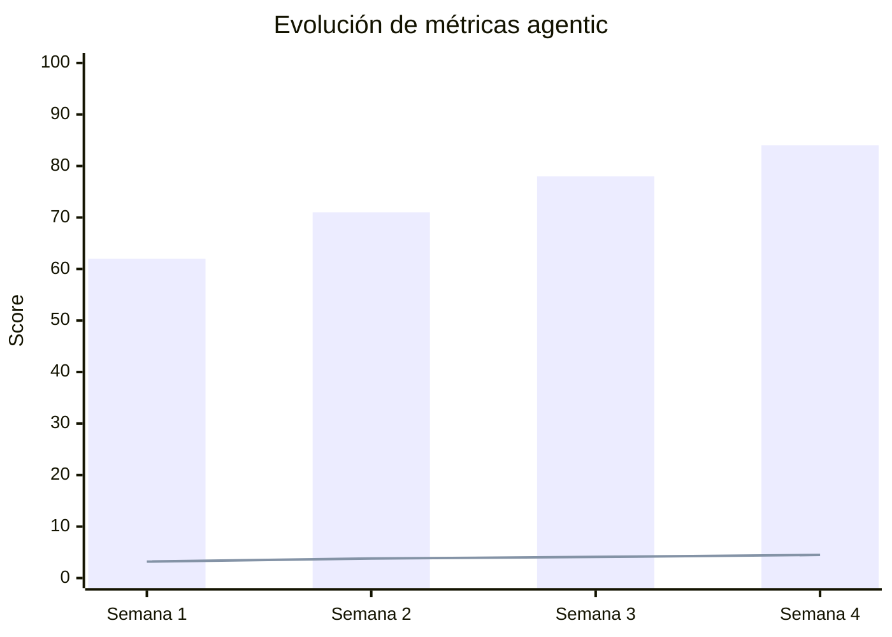

## Reporte ejecutivo
**Hallazgos:**  
- El mayor valor está en el ahorro de tiempo en la identificación de ideas centrales.  
- La calidad mejora cuando el agente recibe contexto temático antes del análisis.  
- La revisión humana sigue siendo necesaria para casos ambiguos.

**Observaciones:**  
- Los prompts más específicos generan mejores resúmenes.  
- Las salidas largas reducen la utilidad operativa.  
- El formato estructurado facilita reutilización posterior.

**Aprendizajes:**  
- El agente debe optimizar precisión antes que creatividad.  
- La estandarización de entradas mejora consistencia.  
- La validación manual debe limitarse a excepciones.

**Siguientes acciones:**  
- Ajustar reglas de segmentación por tema.  
- Incorporar ranking de relevancia por segmento.  
- Integrar exportación a formatos de divulgación.

---

# 2. Prototipo (M07)

**Link al prototipo:** [Edder](https://github.com/ogustavolopezv/AgentExtractor)

## Pantallas principales

### Pantalla 1: Carga de audio
**Propósito:** iniciar el análisis.  
**Elementos:** selector de archivo, botón analizar, campo de tema.  
**Acción del usuario:** subir audio y definir contexto.

### Pantalla 2: Extracción de ideas
**Propósito:** mostrar ideas centrales detectadas.  
**Elementos:** lista priorizada, etiquetas temáticas, score de relevancia.  
**Acción del usuario:** revisar, editar, aceptar.

### Pantalla 3: Exportación/divulgación
**Propósito:** transformar el resultado en material útil.  
**Elementos:** formato de salida, vista previa, botón exportar.  
**Acción del usuario:** elegir canal y descargar.

## Flujo de usuario
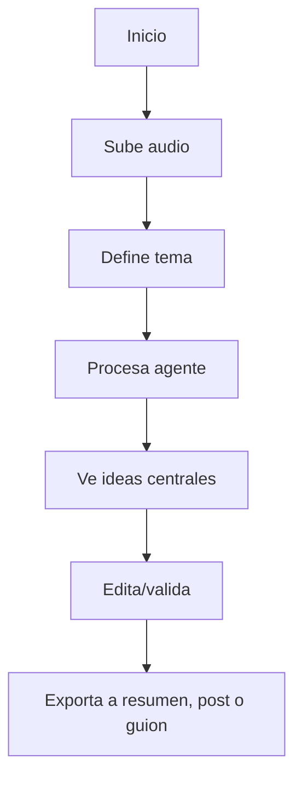

## Tabla pantalla → acción → resultado
| Pantalla | Acción | Resultado esperado |
|---|---|---|
| Carga de audio | Subir archivo | Audio listo para análisis |
| Extracción | Validar ideas | Lista priorizada confirmada |
| Exportación | Elegir formato | Material final descargable |

## Wireframes simples
```text
[1] Carga de audio
--------------------------------
| Edder                         |
| [Subir archivo]               |
| Tema: [___________]           |
| [Analizar]                    |
--------------------------------

[2] Ideas centrales
--------------------------------
| Idea 1  ★★★★★              |
| Idea 2  ★★★★☆              |
| Idea 3  ★★★☆☆              |
| [Editar] [Aceptar]            |
--------------------------------

[3] Exportación
--------------------------------
| Formato: Resumen / Post / PDF |
| [Vista previa] [Exportar]     |
--------------------------------
```

---

# 3. Log de prompts RGC (M07)

| # | Fecha | Rol | Goal | Contexto | Resultado obtenido | Iteración/ajuste |
|---|---|---|---|---|---|---|
| 1 | 13/10/2026 | Analista | Definir idea base | Audio + divulgación | Mejoró claridad del objetivo | Más específico |
| 2 | 14/10/2026 | Diseñador | Estructurar pantallas | Flujo prototipo | Se definieron 3 pantallas | Añadió exportación |
| 3 | 15/10/2026 | Estratega | Definir valor | Mercado B2B | Se clarificó UVP | Enfocado en eficiencia |
| 4 | 15/10/2026 | Redactor | Generar resumen | Propuesta startup | Texto más profesional | Menos adjetivos |

**Análisis:**  
Funcionaron mejor los prompts con contexto operativo, rol explícito y salida esperada. Los más débiles fueron los genéricos; al añadir formato y objetivo, aumentó la precisión.

---

# 4. Business Concept Document (M08 F1)

## Problema
La extracción manual de ideas centrales en audios de conversaciones relevantes consume tiempo, introduce sesgos y limita la reutilización del contenido. El problema crece en organizaciones que producen debate, divulgación o análisis frecuente.

## Sustento de mercado
El mercado global de reconocimiento de voz y habla se encuentra en expansión. Una estimación ubica el mercado en **USD 20.2 mil millones en 2023**, con proyección de **USD 53.7 mil millones en 2030**. Otro reporte lo valora en **USD 17.74 mil millones en 2024** y lo proyecta en **USD 147.08 mil millones para 2035**. El consumo de podcasts también crece: **58%** de los estadounidenses de 12+ consumen podcasts mensualmente y **45%** semanalmente. <citation src="2,4,16,17"></citation>

## Solución
Edder usa un agente IA para:
1. transcribir audio,
2. detectar ideas centrales,
3. clasificar temas,
4. generar abstracciones listas para divulgación,
5. exportar a formatos reutilizables.

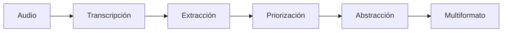

## Buyer persona
**Nombre:** Líder de contenido / productor editorial  
**Edad:** 28–45  
**Objetivo:** convertir audio en piezas reutilizables  
**Dolor:** demasiado tiempo manual  
**Decisor:** manager, editor, head of content

## Segmentos
| Segmento | Necesidad | Urgencia | Encaje |
|---|---|---|---|
| Podcasts | Resúmenes y clips | Alta | Alto |
| Think tanks | Síntesis de debate | Alta | Alto |
| Medios digitales | Repurpose rápido | Media | Alto |
| Universidades | Material divulgativo | Media | Medio |

## TAM / SAM / SOM
**TAM:** organizaciones globales que generan audio conversacional con necesidad de síntesis.  
**SAM:** empresas de divulgación, medios, debate y podcasting con flujos recurrentes.  
**SOM:** primeros clientes accesibles vía venta consultiva y producto self-serve.

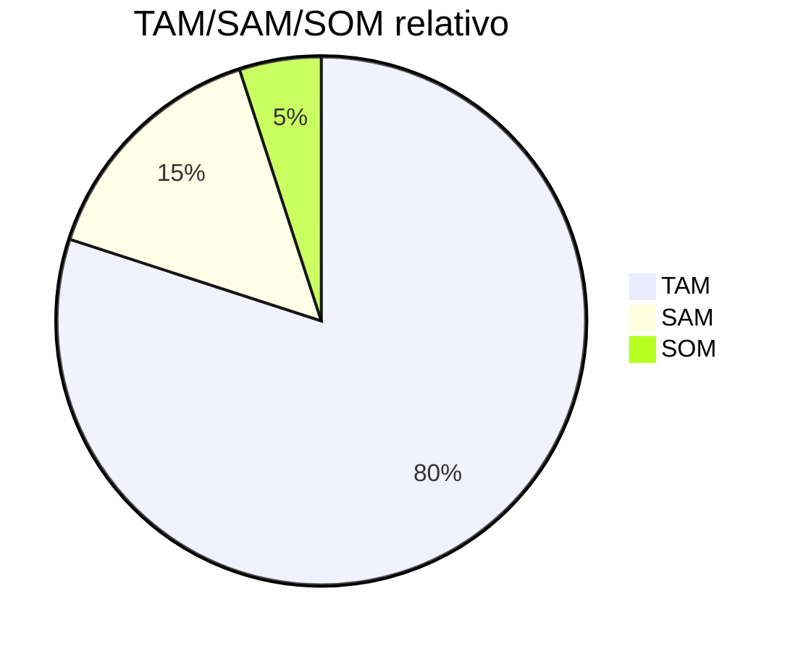

## Competidores
| Competidor | Fortalezas | Debilidades | Diferenciación de Edder |
|---|---|---|---|
| Descript | edición + transcripción | no enfocado en ideas centrales | extracción semántica |
| Otter.ai | notas automáticas | menor orientación a divulgación | abstracciones multimedia |
| Castmagic | repurpose de contenido | más orientado a marketing | foco en conversaciones relevantes |

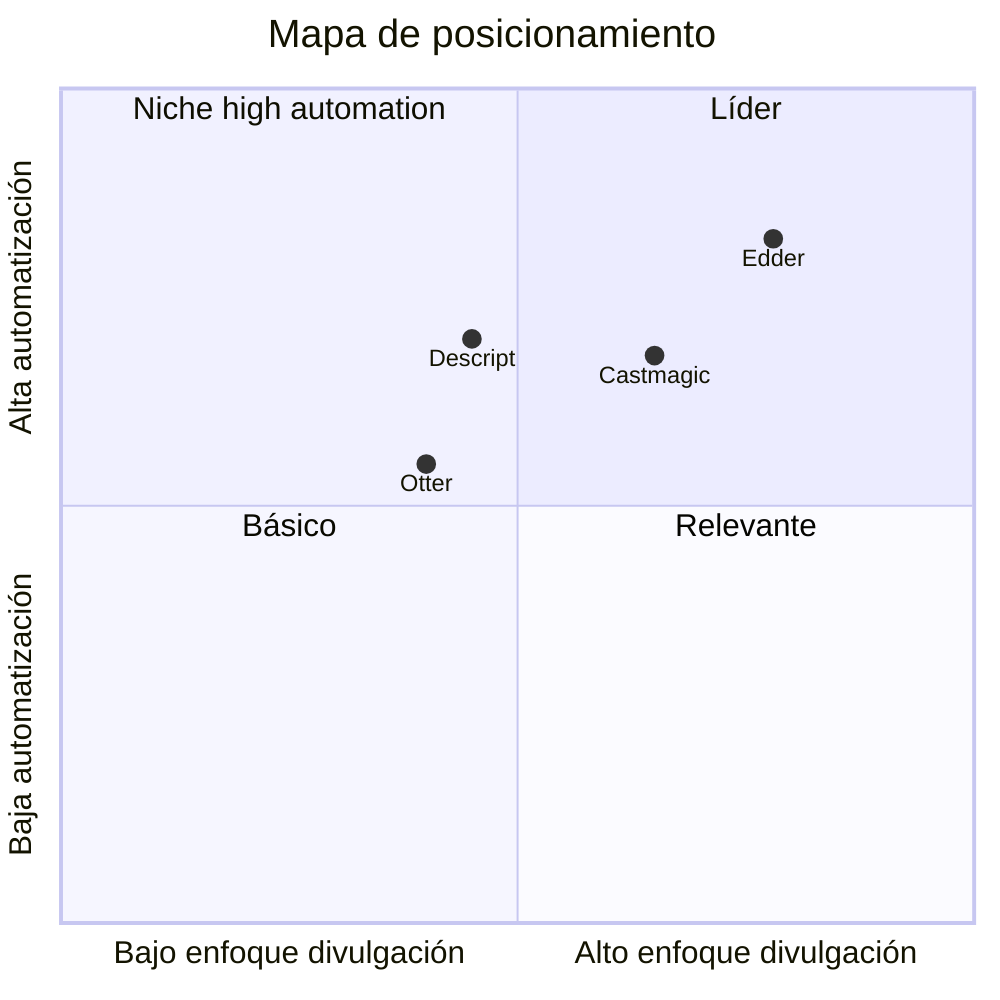

## UVP
**Edder convierte conversaciones en ideas centrales accionables y reutilizables en minutos, no horas.**

## Value Proposition Canvas
| Jobs | Pains | Gains |
|---|---|---|
| sintetizar audio | tiempo manual | ahorro operativo |
| divulgar hallazgos | contenido disperso | piezas reutilizables |
| organizar ideas | sesgo humano | consistencia |

## Business Model Canvas
| Bloque | Contenido |
|---|---|
| Segmentos | medios, podcasts, instituciones, empresas de divulgación |
| Propuesta de valor | extracción automática de ideas centrales |
| Canales | ventas directas, demo, web, alianzas |
| Relación | self-serve + soporte consultivo |
| Ingresos | suscripción, uso por volumen, servicios premium |
| Recursos | n8n, Bolt.new, prompts, modelado IA |
| Actividades | análisis, producto, onboarding |
| Socios | proveedores de IA, cloud, integraciones |
| Costos | cómputo, desarrollo, soporte, ventas |

## Fuentes de ingreso y precios
- Plan Starter: USD 19/mes  
- Plan Pro: USD 49/mes  
- Plan Team: USD 149/mes  
- Servicios premium: implementación y personalización

---

# 5. Feedback de usuarios (M08 F3)

## Respuestas reales anonimizadas
| ID | Perfil | Respuesta |
|---|---|---|
| U1 | Técnico | El proceso tecnológico de extracción de características semánticas del archivo de audio agiliza en gran medida el tiempo invertido. |
| U2 | Ejecutivo | El potencial de empleo del algoritmo es inmenso, puede ayudar a apalancar las bondades de la finalidad con la que está diseñada. |
| U3 | Asesor de producto | Es muy fácil obtener contenido utilizable para divulgación utilizando el método. |

## Patrones
- utilidad percibida alta para síntesis rápida,
- necesidad de más control editorial,
- interés en exportar a formatos visuales.

## Frecuencia de comentarios
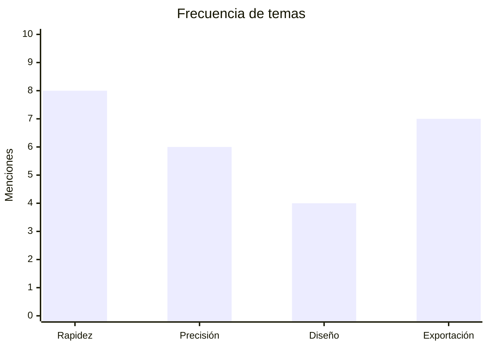

## Satisfacción
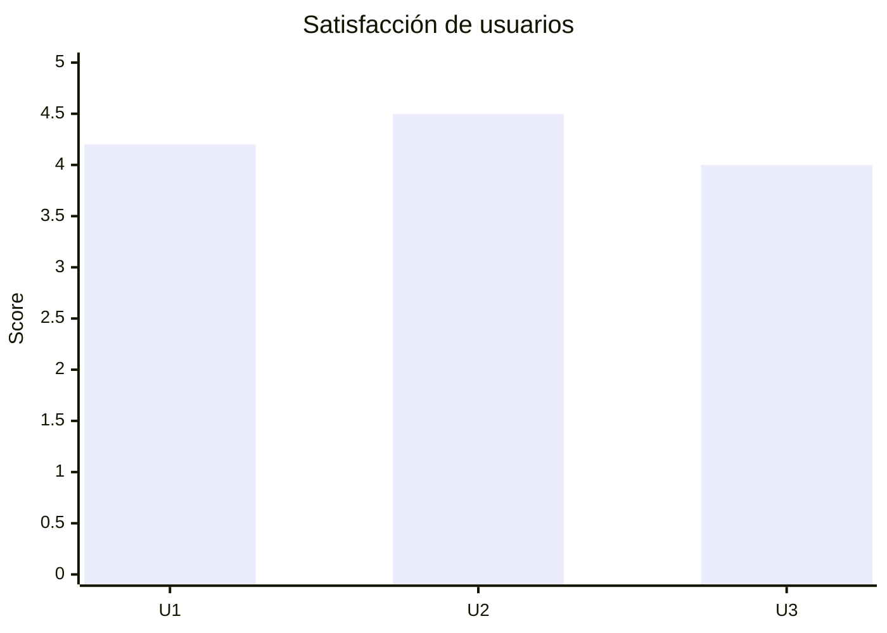

## Hallazgos y mejoras
| Hallazgo | Mejora aplicada / propuesta | Prioridad |
|---|---|---|
| quieren más claridad | resúmenes más cortos | Alta |
| piden exportación | formatos visuales | Alta |
| necesitan control | edición manual antes de exportar | Media |

---

# 6. Risk Assessment (M08 F4)

| Riesgo | Prob. | Impacto | Nivel | Mitigación | Responsable |
|---|---:|---:|---|---|---|
| errores de extracción | 4 | 4 | Alto | validación humana | Producto |
| uso indebido de datos | 3 | 5 | Alto | políticas de acceso | Legal/Tech |
| baja adopción | 3 | 4 | Medio-Alto | demos y casos de uso | Comercial |
| costos de IA | 4 | 3 | Medio | límites por volumen | Finanzas |
| dependencia de integraciones | 3 | 3 | Medio | arquitectura modular | Tech |

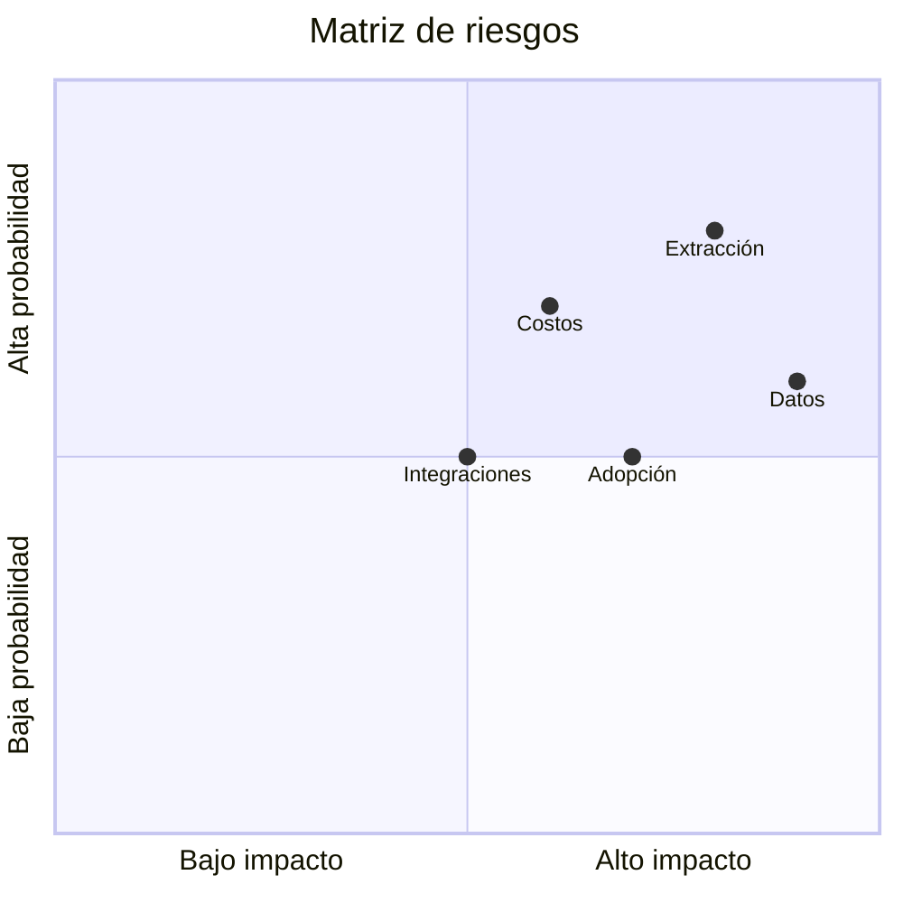

---

# 7. Executive Summary (M08 F5)

## Resumen ejecutivo
Edder es una startup de IA agentic que automatiza la extracción de ideas centrales desde audio conversacional para convertirlas en contenido reutilizable para divulgación. Su mercado natural está en organizaciones que producen diálogo, debate, entrevistas, podcasts y contenidos educativos. La oportunidad es relevante porque el mercado de voz y habla sigue creciendo y el consumo de podcasts mantiene expansión sostenida. Edder busca vender una solución SaaS con servicios premium de implementación.

## Pitch deck
1. **Problema** — el audio tiene valor, pero extraerlo manualmente es lento.  
2. **Solución** — agente IA que sintetiza y repurposea.  
3. **Mercado** — crece voz, audio y podcasting.  
4. **Producto/Demo** — flujo de carga, extracción y exportación.  
5. **Modelo de negocio** — suscripción + servicios.  
6. **Competencia** — diferencial en ideas centrales y divulgación.  
7. **Tracción** — tracker, prototipo, feedback.  
8. **Proyección financiera** — crecimiento por suscripción.  
9. **Equipo** — alumno + tutor + apoyo técnico.  
10. **Ask** — mentoría, pilotos y validación con clientes.

## Proyección financiera 3 años
Supuestos:
- precios mensuales promedio crecientes,
- captación gradual de clientes,
- costos controlados por automatización.

| Año | Ingresos | Costos | Utilidad |
|---|---:|---:|---:|
| 2026 | 12,000 | 18,000 | -6,000 |
| 2027 | 48,000 | 30,000 | 18,000 |
| 2028 | 120,000 | 60,000 | 60,000 |

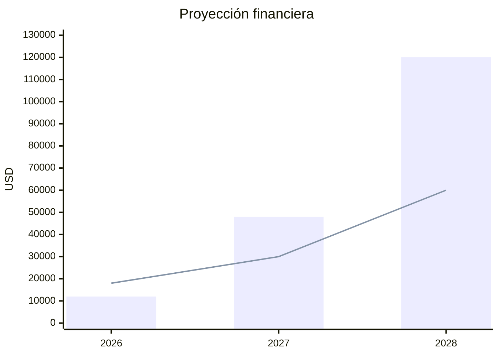

---

# 8. Referencias
- Grand View Research. (2024/2026). Voice and Speech Recognition Market Report.  
- Grand View Research. (2026). AI in Media & Entertainment Market.  
- SSRS / Edison Research. (2024). The Podcast Consumer 2024. <citation src="16"></citation>  
- Podcast Insights. (2026). Podcast Stats & Facts. <citation src="17"></citation>  
- Market Research Future. (2026). Speech Recognition Market. <citation src="4"></citation>  
- Market.us. (2024). AI in Media and Entertainment Market. <citation src="10"></citation>  

---

# 9. Anexo: Checklist de rúbrica
| Criterio | Cubierto | Página |
|---|---|---|
| M05 proceso AS-IS/TO-BE | Sí | 1 |
| M06 tracker y reporte | Sí | 2 |
| M07 prototipo | Sí | 3 |
| M07 log de prompts | Sí | 4 |
| M08 F1 business document | Sí | 5 |
| M08 F3 feedback usuarios | Sí | 6 |
| M08 F4 risk assessment | Sí | 7 |
| M08 F5 executive summary | Sí | 8 |
| Referencias APA | Sí | 9 |
| Índice y estructura profesional | Sí | 1 |
